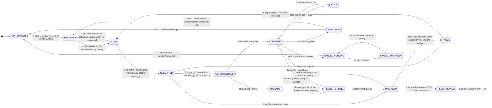

# Design review: protective GTTs sized from confirmed fills

**Status: DESIGN AND AUDIT ONLY. Nothing implemented, nothing enabled.**
This document proposes a lifecycle. It changes no code, test, configuration or database. It does
not authorise any implementation phase, broker operation or live trading. Each phase in §12 needs
its own separate authorisation.

`backend/live_entry_gate.LIVE_ENTRIES_ENABLED` **stays `False`**. Recommendation: **NO-GO** for
live entries (§13).

This review supersedes nothing. `docs/PROPOSAL_EXECUTION_GTT_AFTER_FILL.md` (the earlier,
shorter proposal) is left unchanged. Where this review disagrees with it, the difference is called
out in §5.9.

---

## 0. Recorded starting state (2026-11-05)

| Item | Value | How it was established |
|---|---|---|
| Branch | `feature/signal-detail-and-strategy-revision` | `git branch --show-current` |
| HEAD | `35a0e07fd24a0dd1eb9e0d3ebf9c4b4c8d089fef` ("docs: final order-path remediation status; execution.py GTT-after-fill proposal") | `git rev-parse HEAD` |
| Working tree | **Dirty.** 31 tracked files modified (+1098 / −275), in `backend/`, `frontend/` and `tests/`. 8 untracked files: `backend/broker_holdings.py`, `backend/gtt_cancellation.py`, `docs/AUDIT_REMEDIATION_S2_G7_E3_M3_C4_C8.md` and five test files. This is the uncommitted S2/G7/E3/M3/C4/C8 remediation. Nothing was staged, committed, stashed or reverted. | `git status --porcelain` |
| Basis of this review | The **working tree**, uncommitted changes included. Where behaviour comes from uncommitted code, for example C4 cancellation read-back or C8 holdings identity, this report says "working tree". | — |
| `LIVE_ENTRIES_ENABLED` | `False` (`backend/live_entry_gate.py:40`) | read from source |
| `backend/execution.py` | **Unchanged** versus HEAD (empty `git diff`) | `git diff HEAD -- backend/execution.py` |
| PK-25 frozen hashes | **13 / 13 match**: 2 model files and 11 production files in `research/pk25/validation_manifest.json` → `model_freeze`. Checked as sha256 with CRLF→LF normalisation, as PK-25 specifies. `backend/execution.py` = `0ac96482…c0bf`. Manifest `git_head` = `5391586…`. | recomputed locally |

### 0.1 What was and was not done

- Done: read the repository, plus the source of the installed `kiteconnect==5.0.1` library
  (`.venv/Lib/site-packages/kiteconnect/connect.py`). No broker connection. No Kite MCP tool. No
  network.
- **The FakeKite test suite was not run.** `tests/conftest.py` imports `backend.main`, and
  `backend/main.py:5-7` calls `load_dotenv()` at import. That reads the real repository `.env` into
  the test process. The conftest comment at `tests/conftest.py:44-46` acknowledges this. The
  real-data guard (`tests/real_data_guard.py`) protects the database and its backups, but not
  `.env`. Rule 7 forbids opening `.env`, so running pytest would have broken it. I only checked
  whether `.env` exists, which does not open it. The tests were inventoried statically instead
  (§9.1). **Finding F-0:** the test harness reads the real `.env`. Phase 0 (§12) fixes this before
  any test-driven implementation.
- Nothing was written except this file.

---

## 1. Executive summary

**The defect (verified from code).** `execution._execute_live` (`backend/execution.py:443-550`)
places the entry order (`:468`). As soon as Kite returns an order id, which proves acceptance
only, it calls `kite.place_gtt(...)` (`:484-526`) for the **full ticket quantity**. A CNC SELL GTT
acts on the account's demat holding of the instrument, not on "this entry". Before the entry
fills, or when it fills partially, that GTT can sell shares the terminal never bought. Today the
hard gate (`LIVE_ENTRIES_ENABLED = False`) and interim guards make this unreachable for live
money: MARKET only, no AMO, and no pre-existing quantity of the instrument anywhere in the
account.

**The defect is wider than "GTT before fill".** Tracing the lifecycle found five further
weaknesses in how GTTs are tracked. A fix that only moves the `place_gtt` call would inherit
them:

1. **No durable record of a GTT write before it is sent.** The GTT id is persisted only after
   `execute_ticket` returns (`routes/tickets.py:1285-1296`). A crash or timeout between Kite
   accepting `place_gtt` and that commit leaves a live SELL GTT the app does not know it owns
   (scenarios I and J). `_adopt` then reports "NO protective GTT" (`order_monitor.py:411-419`)
   while one exists.
2. **Ambiguous GTT outcomes count as failures.** `_execute_live` catches every exception after
   `place_gtt` as `protection_failed` (`execution.py:527-540`). `sync_protection` does the same for
   `modify_gtt` (`position_quantity.py:327-331`). A timeout does not prove the write failed.
3. **Mutual exclusion is in-process only.** `position_quantity.protection_lock` is a
   `threading.Lock` (`position_quantity.py:217-223`). `server.py` enforces one worker per server,
   but nothing stops a second server on another port, or a CLI, from running the same loops on the
   same database file. No cross-process instance lock exists.
4. **Kite gives GTTs no idempotency key and no tag.** Verified from `kiteconnect` 5.0.1: the
   `place_gtt` payload is only `condition`, `orders` and `type` (`connect.py:681-738`). A GTT can
   only be identified after the fact by its content (its fingerprint).
5. **Exit and GTT coexist by design (PK-8).** An exit order is placed while the protective GTT
   stays armed (`execution.py:553-566`). Both can sell. The double sale is detected afterwards
   (`POSSIBLE_DOUBLE_SELL`, `position_quantity.py:440-451`), not prevented.

**Proposed design, in one paragraph.** The entry path places the entry order and nothing else. A
new protection engine (`backend/protection.py`, called from the order monitor) creates the GTT
only after the broker reports `filled_quantity > 0`, sized to the confirmed open quantity. Every
broker write that can sell is first recorded in a durable `protection_operations` journal in
SQLite (**write-ahead intent**). That record is guarded by:

- partial unique indexes: at most one open operation per position, and at most one position per
  GTT id;
- a compare-and-set claim in a `BEGIN IMMEDIATE` transaction, which serialises across processes;
- an OS-level single-instance lock with a fencing epoch.

After any ambiguous outcome, the engine never re-sends a `place_gtt`. It reads the GTT book and
adopts exactly one GTT whose fingerprint matches. If none is found within a settle window, the
create is abandoned and only an explicit user action can re-create it. More than one match is
NEEDS_REVIEW. Deletes and downward resizes may be retried automatically, because repeating them
cannot sell anything. Creates and upward resizes may not. Exits:

- **MARKET exits:** cancel and confirm the GTT first, then place the exit.
- **LIMIT exits:** resize the GTT down by the exit quantity first.

No path knowingly leaves an armed SELL GTT against a closed position. A flat position whose GTT
cancellation is not confirmed stays in `CLOSED_CLEANUP_REQUIRED`, which blocks new entries,
instead of `CLOSED`. Startup runs a fixed reconciliation sequence (§8). Until it completes, the
account stays **RESTRICTED** and refuses every new entry.

**The cost, stated plainly.** Between a confirmed fill and a confirmed GTT, the position is
unprotected. While the terminal is running, healthy and logged in, that is typically
`ORDER_MONITOR_INTERVAL_SECONDS` (20 s) plus one or two broker round trips. The proposal lets this
fall to about 5 s while an entry is working. If the terminal is closed, offline, or the Kite
session has expired, the gap lasts until the terminal recovers. This is disclosed before
confirmation and shown live (`PROTECTION_PENDING` with an elapsed timer).

**Broker unknowns that block GO.** None of the following has been answered by an official
source in this review (§10):

- whether DDPI or TPIN authorisation is needed for a GTT-triggered CNC sell when unattended;
- what Kite does when a triggered sell exceeds the sellable quantity;
- whether a GTT placed seconds after a fill is accepted;
- whether `get_gtts()` is read-after-write consistent.

**Recommendation:** NO-GO for live entries. GO to review this design and, once separately
authorised, to implement Phases 0–3, which change no live behaviour. The frozen `execution.py`
change (Phase 4) and lifting the gate (Phase 10) each need their own authorisation and broker
validation.

---

## 2. Current lifecycle (as implemented in the working tree)

### 2.1 Modules, functions, tables

| Step | Module : function (line) | Tables written | Notes |
|---|---|---|---|
| Ticket created / reviewed | `routes/tickets.py` `_create_ticket_internal` (213), risk checks | `trade_tickets` (`draft` → `pending_confirmation`), `ticket_events` | — |
| Confirm (claim) | `routes/tickets.py:confirm_and_execute_ticket` (1099); claim `_transition(... 'confirmed', order_tag, submission_state='submitting', submitted_at)` (~1150-1170) | `trade_tickets`, `ticket_events`, integrity snapshot | A compare-and-set and the PK-12C daily-entry reservation. Committed **before** the broker call. |
| Gates | `_account_safety_precheck` (944), `_revalidate_at_confirm` (858), `_account_safety_final_gate` (970), `_refuse_disabled_live_entry` (995, sits next to the call) | `account_safety_state`, `broker_failure_log` | The final gate runs `live_entry_gate.check_no_presellable_quantity` and `check_market_regular_only`. |
| Entry submission | `execution.execute_ticket` (311) → `_execute_live` (443) → `kite.place_order(tag=kt<id>x<b36>)` (468) | none (in memory) | `DEFINITE_REJECTIONS` → `failed`. Anything else → `submission_unknown` (`unknown_result`, 394). |
| **GTT creation (defect)** | `_execute_live` (480-540): `kite.ltp` then `kite.place_gtt` SINGLE (trailing) or OCO, **quantity = ticket quantity** | none (in memory) | Any exception → `protection_failed`, `kite_gtt_id=None`, status `executed`. |
| Record result | `routes/tickets._record_execution_result` (1276): CAS `confirmed/submitting\|unknown` → `executed`, `kite_order_id`, **`kite_gtt_id`**, `entry_fill_status='pending'`, `filled_quantity=0`, `submission_state='acknowledged'` | `trade_tickets`, `ticket_events` | **The first durable trace of the GTT id.** |
| Late result | `_reconcile_late_result` (1312): attaches `kite_gtt_id` if the monitor adopted first | `trade_tickets`, `reconciliation_log` | — |
| Unknown submission recovery | `order_monitor._reconcile_submission` (339): tag search → `_adopt` (383) / `_not_found` (439) / `_needs_review` (422) | `trade_tickets`, `ticket_events`, `reconciliation_log` | **`_adopt` never creates a GTT** (411-419). |
| Fill following | `order_monitor.check_pending_orders` (180) → `_follow_pending` (262) | — | Every 20 s (`config.ORDER_MONITOR_INTERVAL_SECONDS`). Today's order book, then `order_history`. |
| Partial fill (working) | `_entry_fill_in_progress` (509): `position_quantity.record_fill` (monotonic CAS, 164), then `sync_protection` (243) → `modify_gtt` down to the filled quantity | `trade_tickets.filled_quantity`, `ticket_events`, `reconciliation_log` | — |
| COMPLETE | `_resolve_entry` (552-605): CAS `pending → filled`, `record_fill`, `sync_protection` if earlier partials, then `_gtt_is_active` verification | same | Missing GTT → URGENT `PROTECTION_MISSING`. **No GTT is created.** |
| Ended after partial | `_resolve_entry` (608-626): `entry_fill_status='partial'`, resize | same | — |
| Rejected / cancelled, 0 filled | `_resolve_entry` (628-649): `status='cancelled'`, then `gtt_cancellation.cancel` (delete + read-back) | `trade_tickets.kite_gtt_id` cleared **only if confirmed**; findings `GTT_CANCEL_FAILED` / `_OUTCOME_UNKNOWN` | Working tree (C4). |
| Unconfirmed | `_mark_unconfirmed` (476): an order from an earlier day is no longer in the book → `entry_fill_status='unconfirmed'` | — | Lifecycle `NEEDS_REVIEW`. |
| GTT modification | `position_quantity.sync_protection` (243-336; modify 317-326; any exception = mismatch); `trailing_engine._try_ratchet` (773-843; modify 811); `trailing_engine._converge_protection` (230) | `ticket_events`, `reconciliation_log` | `protection_lock` is an **in-process** `threading.Lock`. Read-back verification in `_verify_resize` (339). |
| GTT cancellation | `gtt_cancellation.cancel` (one delete, then a mandatory read-back; never retried); callers: `_resolve_entry`, `position_quantity.remove_protective_gtt` (415), `routes/orders.cancel_gtt` (165) | findings | Working tree (C4). |
| GTT watcher | `trailing_engine._tick_sync` → `monitored_positions` (61; excludes `pending` entries) → `_process_ticket` (194) → `_handle_inactive_gtt` (268) → evidence via the GTT's `orders[].result.order_result.order_id` (320-370) | synthesized GTT exit tickets, `closed_trades` | Every 45 s. |
| Exit (manual / strategy) | `execution._execute_exit` (553): order only; **the position's GTT stays armed** (PK-8) | `trade_tickets` (exit row) | Unique index `idx_trade_tickets_one_exit_owner` (`db.py:963`) allows one in-flight exit per position. |
| Exit fill | `_resolve_exit` (707) / `_finalize_exit` (787) → `close_if_flat` (375) → `journal.close_position_for_exit` → `remove_protective_gtt` (415) | `trade_tickets.closed_at`, `closed_trades` | GTT `triggered` alongside a filled exit → `POSSIBLE_DOUBLE_SELL`. |
| Emergency Exit | `routes/kill_switch.emergency_exit_confirm` (90) → `_broker_snapshot` (237) → `_exit_one` (359): `_cancel_unfilled_entry` (68), `_refresh_entry_fill` (447), `_reconcile_exit` (290), then `confirm_and_execute_ticket` | exit tickets, `system_events` | Refuses on external SELLs, shortfalls or unreadable data (working tree, E3). |
| Reconciliation | `reconciliation._run_cycle` (167), every 180 s: `_check_order_status`, `_check_gtt_state`, `_check_broker_gtts` (585; orphan / unlinked / duplicate, two-cycle confirmation in `_reverse_seen`), `_check_position_state` (746; shortfall by exchange and symbol, C8) | `reconciliation_log` | In-memory cross-cycle state (`_reverse_seen`, `_price_seen`, `last_cycle`). |
| Protection display | `lifecycle._protection` (458): PROTECTED only from a fresh **broker observation** (`gtt_observations`, process memory, max age 420 s) | none | After a restart everything is UNVERIFIED (by design, S2). |
| Startup | `main.on_startup` (107): runtime policy (one worker, loopback), `init_db`, ticker, `workers.supervisor.start` (5 loops) | — | **No startup reconciliation gate.** Loops start immediately and each runs on its own interval. |
| Shutdown | `main.on_shutdown` (155): `supervisor.stop(timeout=10 s)` | — | A broker call already in a worker thread cannot be interrupted (`workers.py` docstring). |

Tables involved: `trade_tickets` (the primary state), `ticket_events` (audit; `event_type` is a
CHECK-constrained enum, so a new value needs a table rebuild migration, as in
`db._ensure_*_event_type`), `reconciliation_log` (findings, resolved only by human review),
`closed_trades` (journal; unique per sell ticket and per position), `system_events`,
`account_safety_state`, `broker_failure_log`, and the paper-broker tables for dry run.

### 2.2 Order states as the code distinguishes them

| Concept | Broker evidence | Where recorded | Notes |
|---|---|---|---|
| **Submitted (claimed)** | none | `status='confirmed'`, `submission_state='submitting'` | Local intent only. |
| **Outcome unknown** | none (ambiguous error, or the process died) | `submission_state='unknown'`, or `submitting` older than 120 s | Resolved by tag. Never resubmitted. |
| **Accepted** | `place_order` returned an order id, or a tagged order was found | `status='executed'`, `entry_fill_status='pending'`, `filled_quantity=0` | **Not a fill.** Today the full-quantity GTT is created at exactly this point. |
| **Open** | book status `OPEN`, `AMO REQ RECEIVED`, `TRIGGER PENDING`, …, `filled_quantity=0` | unchanged (`pending`) | — |
| **Partially filled** | non-terminal status with `filled_quantity > 0` | `filled_quantity` raised monotonically | Lifecycle `ENTRY_PARTIAL`. |
| **Completely filled** | `COMPLETE` (filled = quantity) | `entry_fill_status='filled'`, `filled_price`, `filled_at` | — |
| **Rejected** | `REJECTED`, 0 filled | `status='cancelled'`, `entry_fill_status='rejected'` | — |
| **Cancelled** | `CANCELLED`, 0 filled | `status='cancelled'`, `entry_fill_status='cancelled'` | — |
| **Ended after partial** | `CANCELLED` / `REJECTED` with filled > 0 | `entry_fill_status='partial'` | An open position of exactly the filled quantity. |
| **Unconfirmed** | the order has left the book (an earlier day) | `entry_fill_status='unconfirmed'` | Treated as open; NEEDS_REVIEW. |

### 2.3 Current lifecycle diagram

```
 UI confirm ──► CLAIM (tx, commit)                       [trade_tickets: confirmed/submitting, order_tag]
                  │
                  ▼
           place_order(tag) ──────── DEFINITE_REJECTION ──► failed/rejected
                  │       └──────── ambiguous ──────────► confirmed/unknown ──► order_monitor tag search
                  │ order_id                                                   ├─ 1 match → adopt (NO GTT ever)
                  ▼                                                            ├─ none/window → not_found
        ┌──── ltp + place_gtt(FULL ticket qty) ◄── DEFECT                      └─ several → needs_review
        │         │ ok                 │ any exception (incl. timeout: GTT MAY EXIST)
        │         ▼                    ▼
        │   result(gtt_id)      result(protection_failed, gtt_id=None)
        │         └─────────┬──────────┘
        │                   ▼      ◄── crash here: GTT live, id never stored (orphan)
        │   _record_execution_result (tx, commit)  [executed/pending, kite_gtt_id, filled_quantity=0]
        │                   │
        │                   ▼  order_monitor every 20 s
        │   OPEN, 0 filled ──► (GTT for full qty is ARMED: can sell pre-existing holdings)
        │      │ partial fill ──► record_fill ──► modify_gtt down to filled
        │      │ COMPLETE ──────► filled; verify GTT active (never create)
        │      │ ended partial ─► partial; modify_gtt to filled
        │      └ rejected/cancelled, 0 filled ──► cancel GTT (read-back); cancelled
        ▼
   OPEN position ──► trailing watcher (45 s): ratchet modify, resize, inactive → evidence
        │            reconciliation (180 s): orphan / unlinked / shortfall findings
        ├─ exit placed (GTT stays armed) ──► exit fill ──► close_if_flat ──► cancel GTT (read-back)
        ├─ GTT triggers ──► GTT order (no tag) ──► fill evidence ──► synthesized exit, close
        └─ Emergency Exit ──► snapshot, reconcile ──► cancel unfilled entry / exit open qty (GTT stays armed)
```

---

## 3. Target state machine

### 3.1 Principles

1. **Facts and inferences are separate types.** Every state is labelled **B** (broker-confirmed:
   a broker response or read proves it), **L** (local: the app's own durable record of its intent)
   or **I** (inferred from absence, timing or matching, never proof). Only B states may unlock a
   broker write that can sell more.
2. **Write-ahead intent.** A broker write that can sell is committed as an intent row before the
   request leaves the process. A crash at any point leaves a row that says what may exist at the
   broker.
3. **Asymmetric retry.**
   - A write that can only *reduce* sell exposure may be retried automatically: delete, resize
     down.
   - A write that can *create or increase* sell exposure is never blindly re-sent: create, resize
     up.
4. **Orthogonal regions.** One composite state per position, made of three regions: Entry
   (order facts), Protection (GTT facts) and Position (holding and exit facts). Plus one
   account-level restriction state. The UI shows one primary label (§3.6).

### 3.2 Entry region (E)

| State | Type | Meaning | Persisted as (existing columns kept) |
|---|---|---|---|
| `ENTRY_SUBMITTED` | L | Claimed; the broker call is about to start or in flight | `confirmed` / `submitting` |
| `ENTRY_OUTCOME_UNKNOWN` | L/I | Ambiguous broker response, or a stale claim | `confirmed` / `unknown` |
| `ENTRY_ACCEPTED` | B | Order id returned or tagged order found; filled = 0 | `executed` / `pending`, `filled_quantity=0` |
| `ENTRY_PARTIALLY_FILLED` | B | Working, 0 < filled < quantity | `executed` / `pending`, `filled_quantity=f` |
| `ENTRY_FILLED` | B | COMPLETE | `filled` |
| `ENTRY_ENDED_PARTIAL` | B | Ended with 0 < filled < quantity | `partial` |
| `ENTRY_REJECTED` / `ENTRY_CANCELLED` | B | Ended with 0 filled | `cancelled` + `entry_fill_status` |
| `ENTRY_NOT_PLACED` | I | No tagged order within the window, same day | `failed` / `not_found` |
| `ENTRY_UNCONFIRMED` | I | Left the order book unresolved | `unconfirmed` → `RECONCILIATION_REQUIRED` |

### 3.3 Protection region (P)

| State | Type | Meaning |
|---|---|---|
| `PROTECTION_NOT_REQUIRED` | L | Nothing filled yet, `use_gtt=0`, or the position is closed with its GTT cleanup confirmed |
| `PROTECTION_PENDING` | L | A confirmed fill exists (`filled_quantity > 0`) with no linked and confirmed GTT. **Unprotected and shown as such.** |
| `PROTECTION_INTENT` | L | A `create` operation is committed (claimed); pre-write checks are running; nothing sent yet |
| `PROTECTION_SUBMITTED` | L | Operation `sending`: committed immediately before `place_gtt`; the request may be in flight |
| `PROTECTION_ACKNOWLEDGED` | B (ack only) | Kite returned a `trigger_id`; the id is linked; not yet read back |
| `PROTECTION_CONFIRMED` | B | A complete GTT-book read, no older than `GTT_OBSERVATION_MAX_AGE_SECONDS`, shows the linked GTT `active`, on this instrument, every leg a SELL of exactly the open quantity, and trigger and limit prices as intended |
| `PROTECTION_STALE` | I | Was confirmed; the last observation is now too old (no read for over 420 s) |
| `PROTECTION_RESIZE_PENDING` | L | Open quantity ≠ GTT legs; a `modify` operation is needed or claimed |
| `PROTECTION_FAILED` | B | Definite rejection of the create (`OrderException`, `InputException` or `PermissionException`), or a create abandoned after the settle window (I). Unprotected. |
| `PROTECTION_UNKNOWN` | L/I | Ambiguous create or modify outcome; recovery is running (§5.4) |
| `PROTECTION_MISMATCH` | B | A linked GTT exists but its quantity, trigger, instrument or side is wrong (scenario M) |
| `PROTECTION_TRIGGERED` | B | The GTT left `active` as `triggered`; its order now drives an exit (§6) |
| `PROTECTION_CANCEL_PENDING` | L | A `cancel` operation is claimed or sent |
| `PROTECTION_CANCEL_UNKNOWN` | L/I | Delete outcome not confirmed; automatic bounded retries continue |
| `PROTECTION_NEEDS_REVIEW` | I | Contradictory evidence: more than one fingerprint match, a GTT linked to two positions, or an unlinked SELL GTT on the instrument during recovery |

### 3.4 Position region (X)

| State | Type | Meaning |
|---|---|---|
| `NO_POSITION` | B/L | Nothing filled |
| `OPEN` | B | open quantity > 0, no exit in flight |
| `EXIT_PENDING` | L/B | An exit order is claimed or working, or a **triggered GTT's** order is working. Exactly one exit owner (unique index, extended in §6). |
| `EXIT_PARTIAL` | B | Some sold, the rest open |
| `CLOSED_CLEANUP_REQUIRED` | B + L | Broker-proven flat (open = 0, entry ended), but a linked SELL GTT is not yet confirmed cancelled or consumed. **Blocks new entries account-wide.** |
| `POSITION_CLOSED` | B | Flat, journaled, and no armed GTT linked (cancel confirmed, or the GTT itself sold the position) |
| `RECONCILIATION_REQUIRED` | I | The economic state cannot be established from broker evidence: unconfirmed fill, shortfall, external sell, more sold than bought, attribution broken, ambiguous GTT ownership. Needs a human. |

### 3.5 Account restriction state (A)

`NORMAL` (new entries may be considered) or `RESTRICTED(reasons…)`. Reasons:

- `STARTUP_RECONCILIATION_INCOMPLETE`
- `NO_SESSION`
- `PROXY_UNAVAILABLE`
- `BROKER_READ_FAILED`
- `UNRESOLVED_OPERATION`: any open `protection_operations` row, or any entry `unknown` / `needs_review`
- `RECONCILIATION_REQUIRED`: any position
- `CLEANUP_REQUIRED`: any `CLOSED_CLEANUP_REQUIRED`
- `PROTECTION_GAP`: any `PROTECTION_PENDING` / `FAILED` / `UNKNOWN` / `MISMATCH` older than a threshold
- `INSTANCE_LOCK_LOST`

RESTRICTED never blocks exits, cancellations, Emergency Exit or protection upkeep, subject to the
rules in §6. It blocks only new risk. It is derived on every confirmation from persisted state plus
the last startup or cycle outcome, which is persisted (§8). It is never held in memory alone.

### 3.6 Diagram (Protection × Position; the Entry region feeds `filled_quantity`)



Position region: `NO_POSITION → OPEN` (B: fill) → `EXIT_PENDING` (L: exit claimed, or B: GTT
triggered) → `EXIT_PARTIAL` / `OPEN` (B) → flat → `CLOSED_CLEANUP_REQUIRED` (if a linked GTT is
not confirmed gone) → `POSITION_CLOSED` (B: cancel confirmed). Any region → `RECONCILIATION_REQUIRED`
on contradictory evidence. Only a human leaves it, through a reviewed action with a required
reason (the existing `reconciliation_reviewed` mechanism).

**Primary UI label** (precedence order): RECONCILIATION_REQUIRED › CLEANUP_REQUIRED ›
PROTECTION_NEEDS_REVIEW › PROTECTION_UNKNOWN › PROTECTION_FAILED › PROTECTION_PENDING (with timer) ›
EXIT_PENDING › PROTECTION_STALE › PROTECTED (CONFIRMED) › ENTRY states.

### 3.7 Transition rules

| Transition | Broker confirmation required | Transactional (one SQLite tx) | Crash-recoverable | Blocks |
|---|---|---|---|---|
| fill recorded (`record_fill`) | **Yes** (order book `filled_quantity`) | Yes, with its `ticket_events` row | Yes: re-read from the book | — |
| PENDING → INTENT (claim) | No | **Yes**: insert op + `trade_tickets.protection_state`, `BEGIN IMMEDIATE`, epoch check | Yes: an `intent` op with no `sent_at` is aborted on recovery (nothing was sent) | Blocks other creates and modifies for the position; blocks an **exit claim** until it resolves (see §6 for Emergency Exit) |
| INTENT → SUBMITTED | No | **Yes**, committed **before** `place_gtt` | Yes → treated as UNKNOWN on recovery | Same |
| SUBMITTED → ACKNOWLEDGED | **Yes** (response) | **Yes**: op state + `kite_gtt_id` CAS `IS NULL` | Lost response → UNKNOWN → recovery | — |
| → CONFIRMED / STALE | **Yes** (read) | Observation persisted (proposed table, §5.6) | Yes; after a restart, shown STALE or UNVERIFIED until read | — |
| → FAILED (definite) | **Yes** | Yes | — | `PROTECTION_GAP` restriction |
| UNKNOWN → adopted / FAILED / NEEDS_REVIEW | **Yes** (complete book reads) | Yes | Yes | Blocks every write on the position until resolved |
| resize | **Yes** (book read before; read-back after) | op claim and resolution: yes | Yes (modify is convergent, §5.5) | Blocks a create; an exit claim waits for or supersedes it (§6) |
| cancel | **Yes** (read-back) | Yes | Yes (automatic bounded retry) | `CLOSED_CLEANUP_REQUIRED` blocks new entries |
| exit claim | No | **Yes**: `NOT EXISTS` open protection op, in the same UPDATE | Existing PK-2 / PK-8 recovery | Blocks protection create and modify-up |
| close (flat) | **Yes** (exit COMPLETE) | Yes: `closed_at`, journal, cleanup op claimed in the same tx | Yes | — |

**Stale and missing observations** are represented explicitly, never as defaults:

- `observed_at` and the read's completeness are stored per GTT observation.
- An expected id absent from a complete read is `missing` (as in today's `gtt_observations.record_book`).
- A failed read writes nothing. The previous observation simply ages into STALE.
- A partial or malformed book is not a complete read and cannot prove `missing`.

---

## 4. Failure scenarios

Columns: **Happens**, **Records**, **User sees**, **Broker write allowed?**, **Recovery**,
**Manual?** The current behaviour is given first (*Today*), where it differs.

**A. Entry accepted, zero fills.**
*Today:* a full-quantity SELL GTT is armed for as long as the order rests. `GTT_STAGED_BEFORE_FILL`
warning; lifecycle `PENDING_FILL`.
**Proposed:** no GTT exists. Records `executed/pending`, `filled_quantity=0`, protection
`NOT_REQUIRED`. User sees "ENTRY WORKING · no shares bought · no protection needed yet". Writes
allowed: cancelling the entry; no GTT write. Recovery: the monitor follows the order; an order that
ends with 0 filled becomes CANCELLED or REJECTED with nothing to clean up. Manual: no.

**B. Entry partially filled (still working).**
*Today:* modify the full-quantity GTT down to `f`.
**Proposed:** `record_fill` INCREASED → `PROTECTION_PENDING` → create a GTT for exactly
`open_quantity` (= `f`), after the pre-write checks (§5.3). Later fills → resize-up operation
(§5.5). Records: fill, op rows, events. User sees "ENTRY PARTIAL f/q · PROTECTION PENDING 00:07",
then "PROTECTED f". Writes: one create per position; resize-up only to the confirmed fill. Option
(reviewer decision): a short **debounce** of up to `PROTECTION_PARTIAL_DEBOUNCE_SECONDS` (proposed
10 s) while the order is still working, to avoid create-then-modify churn on a MARKET order that
completes within seconds. Manual: no.

**C. Multiple partial fills arrive out of order** (for example, the monitor reads `f=60`, then a
slower reader reports `f=40`).
`record_fill` is a monotonic CAS (`position_quantity.py:164-186`): a lower figure returns `STALE`
and is ignored. Sizing always re-reads the database inside the operation's claim transaction, so
an operation sized from 40 cannot be claimed after 60 is recorded: the claim recomputes. A modify
in flight sized for 60 that resolves after a later 80 → the convergence check opens another resize
operation. Records: only increases. User sees the latest figure. Writes: at most one open
operation per position (unique index). Manual: no.

**D. Duplicate fill event.**
`record_fill` → `UNCHANGED`, no operation. A second process seeing the same COMPLETE loses the
`_claim_pending` CAS (`order_monitor.py:467-473`). Creating an operation requires (a) no open
operation and (b) `kite_gtt_id IS NULL`, both checked in the same tx, so a duplicate cannot create
a second GTT. Manual: no.

**E. Entry fully filled.**
COMPLETE → `filled` → `PROTECTION_PENDING` → create a GTT for `open_quantity`, then read-back →
`CONFIRMED`. User sees "PROTECTION PENDING" for seconds, then "PROTECTED". Manual: no. If the
create fails definitively → `PROTECTION_FAILED`, URGENT, "place a stop in Kite or Re-create".

**F. Entry rejected.**
`cancelled/rejected`; no GTT ever existed; nothing to clean up. *Today:* the full-quantity GTT has
to be deleted and the deletion confirmed. That delete can fail (C4 finding), which the proposed
design removes as a failure mode. Manual: no.

**G. Entry cancelled after a partial fill.**
`partial`; open = `f`. If the GTT was already created for `f` (from B), nothing changes. If the
partial arrived only in the final read → create for `f`. The unfilled remainder is never
protected. Manual: no.

**H. Crash after the entry fill but before GTT creation.** *(Critical.)*
- Variant H1: the crash happens before the fill is recorded. On restart the monitor reads the book
  (same day) → records the fill → `PROTECTION_PENDING` → create.
- Variant H2: the fill is recorded and no operation is claimed. Startup step 7 (§8) finds
  `PROTECTION_PENDING` positions → create after the pre-write checks.
- Variant H3: the operation is in `intent` (claimed, nothing sent; `sent_at IS NULL`). Recovery
  marks it `abandoned (not sent)`, which is safe because no request left the process, then claims
  a fresh create.
- Variant H4: the crash happens on another day. The order book no longer has the order, so the
  fill cannot be read → `ENTRY_UNCONFIRMED` → `RECONCILIATION_REQUIRED`. The user confirms the fill
  from Kite's trade history (attestation, §7.4) before any automated protection.

Records: everything is durable. User sees an "UNPROTECTED since <fill time>" banner from the
moment the terminal starts. Writes: create allowed in H1–H3, refused in H4 until attestation.
Manual: H4 only.

**I. Crash after Kite accepts the GTT, before the GTT id is stored.** *(Critical.)*
The operation is `sending` (committed before the call) with its `request_fingerprint`.
- On restart, `sending` from a dead epoch → `UNKNOWN`. Recovery reads the **complete** GTT book.
- Candidates: active SELL GTTs whose fingerprint equals the request's (exchange, symbol, type,
  sorted trigger values, and per leg: side, quantity, order type, product, price), whose id is not
  linked to any other ticket, and, where the book carries a creation time, created at or after
  `sent_at − 120 s` (unverified field, §10).
- Exactly 1 → adopt (link in a tx), then read-back → CONFIRMED.
- 0 → wait; after `PROTECTION_SETTLE_SECONDS` (proposed 120 s) and at least 2 complete reads at
  least 60 s apart → `FAILED`. "No GTT was created. Re-create?" requires the user.
- More than 1, or any **other** unlinked active SELL GTT on the instrument (ISIN) → `NEEDS_REVIEW`.

*Today:* the GTT is an orphan, `_adopt` claims "NO protective GTT", and `UNLINKED_POSSIBLE_GTT`
appears after two reconciliation cycles (6 min). It is never linked, and the user may add a second
stop, which can double-sell.

Writes: none for the position while UNKNOWN. Manual: only for NEEDS_REVIEW, or to re-create after
FAILED.

**J. GTT placement times out; outcome unknown.** *(Critical.)*
Same as I, without a crash. `place_gtt` raises a non-definite exception: `NetworkException`,
`GeneralException`, `DataException`, raw `requests` errors, `TokenException` (the call may have
landed before the token was judged), `KeyError`, or `TypeError` on a malformed body. → op
`unknown`, `PROTECTION_UNKNOWN`. Recovery runs in the same cycle and later cycles. **Never
re-send.** User sees "PROTECTION UNKNOWN — checking Kite's GTT list; DO NOT place a second stop
yet", with a countdown to the settle deadline. A `TokenException` on `place_gtt` is treated as
ambiguous, unlike on `delete_gtt`, where C4 treats it as a definite refusal. This is deliberate:
the cost of guessing wrong on a create is a duplicate sell order.

**K. Restart while GTT placement is unresolved.**
Startup step 6 (§8) resolves every `intent`, `sending`, `unknown` and `acknowledged` operation
**before** any loop may claim new operations, and before new entries are considered. Without a
session, operations stay unresolved and the account stays `RESTRICTED(NO_SESSION,
UNRESOLVED_OPERATION)`. No write is attempted. The settle-window clock counts complete reads, not
wall time, so days offline cannot turn "never looked" into "proved absent".

**L. An existing matching GTT is found during recovery.**
- Exactly one fingerprint match, linked to nothing, with no other unlinked SELL GTT on the ISIN →
  adopt. This applies **only** to an operation this app recorded as `sending` or `unknown`.
- A matching GTT that **no** operation explains (for example, the user placed an identical one by
  hand) → never adopted; `UNLINKED_POSSIBLE_GTT` as today. The position stays `PROTECTION_PENDING`,
  and creation is **refused** while an unlinked SELL GTT exists on the instrument, because two
  GTTs could double-sell. The user either links it (a reviewed action that records the reason) or
  deletes it in Kite.

**M. Existing GTT with an incorrect quantity or trigger configuration.**
Classified on read-back or in the watcher as `PROTECTION_MISMATCH`, with a reason.

| Mismatch | Automatic action | Why |
|---|---|---|
| legs > open quantity | **resize down** automatically (reduces exposure, safe to retry) | can sell unowned shares |
| legs < open quantity | resize up, only after the pre-write checks (§5.3) | under-protection; increasing exposure needs proof |
| trigger or limit ≠ intended | **flag only**: no automatic trigger rewrite, except the trailing ratchet's own monotonic move | the user may have edited it in Kite deliberately; a rewrite could loosen a stop |
| wrong instrument, BUY leg, or non-CNC product | `NEEDS_REVIEW`; no write | not this app's GTT shape |
| status disabled / rejected / expired | `PROTECTION_FAILED` (not active) | — |

Manual: trigger mismatches and NEEDS_REVIEW.

**N. Position closed while GTT creation or modification is in progress.** *(Critical.)*
1. A normal exit cannot be claimed while a protection operation is open (claim predicate, §6.2),
   so this occurs only through Emergency Exit, a GTT trigger, or external activity.
2. When a create or modify operation resolves, the engine re-reads the position **in the
   resolution tx**:
   - If the position is now `EXIT_PENDING` (MARKET exit) or flat, and the operation produced or
     touched a GTT, a `cancel` operation is claimed in the same tx and executed immediately.
   - The position cannot become `POSITION_CLOSED` until that cancel is confirmed. Until then it is
     `CLOSED_CLEANUP_REQUIRED`.
3. If the create's outcome is still UNKNOWN when the position goes flat → `CLOSED_CLEANUP_REQUIRED`
   with "a GTT may exist". Recovery searches the book. A found GTT is cancelled; nothing found after
   the settle window → `POSITION_CLOSED` with the evidence recorded.

User sees "CLOSED — GTT CLEANUP REQUIRED", which blocks new entries. Manual: only if cancels keep
failing.

**O. GTT modification fails.**
- Definite rejection → `PROTECTION_MISMATCH` (current legs kept; the observation is invalidated
  and then re-read).
  - Resize **down** → automatic retry with backoff (1, 2, 4 … capped at 5 min), up to 10 attempts,
    then URGENT and manual.
  - Resize **up** → no automatic retry. URGENT "position partly unprotected: GTT covers g of h".
  - Trailing ratchet: as today, retry next cycle. A ratchet only tightens, so a retry cannot
    loosen the stop.
- Ambiguous → `UNKNOWN`. A read-back tells which quantity and trigger are live, because a GTT
  modify is convergent: the same id and the target values are known. The modify is resolved by
  comparing legs.
- Kite reports the GTT not active (it triggered meanwhile) → `PROTECTION_TRIGGERED` handling.

**P. GTT cancellation fails or times out.**
`gtt_cancellation.cancel` already reads back (C4). Proposed change: **automatic bounded retry**
(backoff, up to 10 attempts, then manual), because a delete of an already-deleted GTT cannot sell
anything. The position (if flat) stays `CLOSED_CLEANUP_REQUIRED`, and the account is RESTRICTED.
`triggered` on read-back during a cancel → it fired → `POSSIBLE_DOUBLE_SELL` check (today's
logic). Manual: after the retries are exhausted, "Delete GTT <id> in Kite".

**Q. User manually buys or sells the same instrument through Kite.**
Detected per ISIN by (a) untagged orders on the instrument in today's book that are not
GTT-linked, and (b) holdings, T1 and day CNC quantities that differ from the app's attribution
ledger (§6).
- External **BUY**: an `external_buy` note. Protection stays at the app's quantity; the GTT is
  never resized to cover the user's extra shares.
- External **SELL** or a shortfall → `RECONCILIATION_REQUIRED` and attribution BROKEN.
  - Automatic **resize-down** to `min(app open, broker attributable)` is allowed.
  - Create and resize-up are refused.
  - Emergency Exit is refused for that instrument (today's E3 rule).
  - The user is told to act in Kite.

Manual: yes, for sells.

**R. Internet, proxy or Kite session unavailable during recovery.**
Every broker read fails closed. Operations stay unresolved; observations age into STALE; the
account is `RESTRICTED(NO_SESSION | PROXY_UNAVAILABLE | BROKER_READ_FAILED)`. No write is
attempted while reads cannot be made, because a write without a pre-write read could duplicate.
GTTs at Kite keep working server-side without this app (inferred, §10). User sees "Broker
unreachable since T; protection last confirmed at T0; N positions with unresolved protection".
Manual: re-login (the daily session) or fix the proxy. Recovery resumes automatically.

**S. Multiple application processes attempt to protect the same position.** *(Critical.)*
Three layers (§5.2):
1. OS single-instance lock: the second process refuses to start its loops and broker-write
   routes.
2. DB fencing epoch, checked inside every claim tx.
3. Partial unique index: at most one open operation per position. SQLite `BEGIN IMMEDIATE`
   serialises writers across processes (WAL mode).

Result: at most one process can hold a claim, and a fenced-out process's claim fails before any
broker call. A process paused by sleep or hibernate that resumes after losing the lock sees an
epoch mismatch at its next claim and stops all broker writes (`INSTANCE_LOCK_LOST`). Its single
possibly in-flight request is covered by its own `sending` row. *Today:* nothing prevents two
servers on two ports from each running an order monitor against one database.

**T. User closes the application for several days while holding an open position.**
- GTTs persist at Kite. Expiry is about one year (inferred, unverified).
- While away: the GTT may trigger and sell; the user may trade in Kite; a corporate action may
  affect the GTT (unverified).
- On return: §8 runs. The order book only covers today, so:
  - a triggered GTT's order from an earlier day is not in `orders()`. Its link
    (`orders[].result.order_result.order_id`) may still be read from the GTT itself. Whether
    `order_history(id)` works for an earlier day's order is unverified;
  - holdings and T1 show the outcome.
- Rules:
  - The GTT is `triggered`, its linked order is unreadable, and holdings fell by exactly the GTT
    quantity → `RECONCILIATION_REQUIRED` with a pre-filled suggested resolution ("GTT sold q on
    <date>?"). Closing needs the user's confirmation. It is never automatic: an inferred fill must
    not be journaled as a broker fill.
  - The GTT is still active, its observation matches, and holdings equal the app quantity →
    `PROTECTION_CONFIRMED` again. No action.
  - Anything else → `RECONCILIATION_REQUIRED`.

New entries stay blocked until every position is CONFIRMED or human-resolved.

---

## 5. Durable idempotency and recovery design

### 5.1 What the broker does and does not give us

| Fact | Status |
|---|---|
| `place_order` takes a `tag` (≤ 20 alphanumeric characters); tagged orders can be found later | Verified from code (`execution.order_tag_for`, `kiteconnect` `place_order(tag=...)`). Kite echoing `tag`/`tags`: assumed by the code and FakeKite; the shape is not re-verified here |
| `place_gtt` has **no** tag, client id or idempotency key; the payload is `condition` (exchange, tradingsymbol, trigger_values, last_price), `orders` (exchange, tradingsymbol, transaction_type, quantity, order_type, product, price) and `type` | **Verified from code**: `kiteconnect/connect.py:681-738` |
| `kiteconnect` does not retry; default timeout 7 s | **Verified from code**: `connect.py:38`; no retry logic in the module |
| GTT statuses: active, triggered, disabled, expired, cancelled, rejected, deleted | Verified from code (`connect.py:99-105` constants). Which ones Kite actually returns, and for how long: unverified |
| `get_gtt(trigger_id)` exists | Verified from code (`connect.py:677`) |
| Kite rejects duplicate identical GTTs | **Unknown. Must not be assumed.** |
| `get_gtts()` is read-after-write consistent | **Unknown** |
| A GTT record carries `created_at` / `updated_at` | Unknown (FakeKite has neither) |

So a durable **local** operation journal plus a **fingerprint** match is the only way to know
whether the app already created a GTT. Broker order ids cannot identify a GTT, which has its own
id that is known only from the response. The broker order id of the entry is still useful as the
operation's parent key.

### 5.2 Mechanisms (all required; none sufficient alone)

1. **Single-instance OS lock.** At startup, open `backend/kite_terminal.instance.lock`
   exclusively. On Windows: `msvcrt.locking(fd, LK_NBLCK, 1)`, or `CreateFile` with no sharing.
   The OS releases it when the process dies, so a stale lock cannot outlive a crash. If the lock
   cannot be taken, the process refuses to start the background loops and every broker-write route
   (HTTP 503 `ANOTHER_INSTANCE_RUNNING`). Read-only pages may still serve.
2. **Fencing epoch.** New table `app_instance(id=1, epoch INTEGER, holder TEXT, started_at,
   heartbeat_at)`. After taking the OS lock: `UPDATE app_instance SET epoch = epoch + 1, …`; the
   process remembers its epoch. Every claim transaction runs
   `BEGIN IMMEDIATE; SELECT epoch … ; <abort if ≠ mine>`, then the claim. SQLite holds a
   cross-process RESERVED lock for the tx, so the check and the claim are atomic against any other
   process using the file.
3. **Operation journal** `protection_operations` (proposed DDL; names are illustrative):

   ```sql
   CREATE TABLE protection_operations (
     id                    INTEGER PRIMARY KEY AUTOINCREMENT,
     op_uuid               TEXT NOT NULL UNIQUE,
     account_id            INTEGER NOT NULL REFERENCES accounts(id),
     position_id           INTEGER NOT NULL REFERENCES trade_tickets(id),
     mode                  TEXT NOT NULL CHECK (mode IN ('live','dry_run')),
     kind                  TEXT NOT NULL CHECK (kind IN ('create','modify','cancel')),
     reason                TEXT NOT NULL,      -- 'fill', 'exit_fill', 'trailing', 'cleanup', 'user_recreate', ...
     state                 TEXT NOT NULL CHECK (state IN
                             ('intent','sending','acknowledged','confirmed','rejected',
                              'unknown','adopted','abandoned','superseded','needs_review')),
     basis_filled_quantity INTEGER NOT NULL,   -- entry fill the op was sized from
     basis_exits_filled    INTEGER NOT NULL,
     requested_quantity    INTEGER NOT NULL CHECK (requested_quantity >= 0),
     request_fingerprint   TEXT NOT NULL,      -- canonical JSON (sorted keys, tick-normalised prices)
     request_payload       TEXT NOT NULL,      -- exactly what was sent
     target_gtt_id         INTEGER,            -- modify / cancel
     result_gtt_id         INTEGER,
     instance_epoch        INTEGER NOT NULL,
     attempts              INTEGER NOT NULL DEFAULT 0,
     complete_reads_after  INTEGER NOT NULL DEFAULT 0,  -- settle-window evidence
     created_at TEXT NOT NULL DEFAULT (datetime('now')),
     sent_at TEXT, acknowledged_at TEXT, resolved_at TEXT, last_checked_at TEXT,
     evidence              TEXT,               -- JSON of the reads that resolved it
     CHECK (kind != 'create' OR attempts <= 1)
   );
   -- one open operation per position (cross-process mutual exclusion)
   CREATE UNIQUE INDEX idx_protection_ops_one_open ON protection_operations(position_id)
     WHERE state IN ('intent','sending','acknowledged','unknown','needs_review');
   -- a GTT protects at most one position
   CREATE UNIQUE INDEX idx_trade_tickets_unique_gtt ON trade_tickets(kite_gtt_id)
     WHERE kite_gtt_id IS NOT NULL;
   ```

   Plus `trade_tickets.protection_state TEXT`, denormalised and written in the same tx as every
   operation transition, for the lifecycle and indexes. Plus new `ticket_events` types
   (`protection_pending`, `protection_submitted`, `protection_confirmed`, `protection_unknown`,
   `protection_adopted`, `protection_cancelled`), through a table-rebuild migration as the
   existing `_ensure_*_event_type` functions do.

   `needs_review` in the open-operation index is intentional: it blocks every further automated
   write on the position until a human resolves it. That is the fail-closed choice.

   The `idx_trade_tickets_unique_gtt` migration must first check existing rows for duplicate
   `kite_gtt_id` values. If any exist, it does not create the index (following the precedent of
   `_ensure_single_exit_owner_index`), raises an URGENT finding, and keeps live entries blocked.
4. **The claim predicate** (one UPDATE / INSERT in the `BEGIN IMMEDIATE` tx) requires:
   - epoch is current;
   - the position is `executed`, not closed, broker-tracked, `use_gtt=1`;
   - `filled_quantity > 0` **recorded from a broker report**;
   - `open_quantity > 0` and known;
   - for a create: `kite_gtt_id IS NULL`;
   - no open operation (index);
   - no exit in flight (`NOT EXISTS … EXIT_IN_FLIGHT_SQL`);
   - the position is not RECONCILIATION_REQUIRED;
   - the instrument attribution is not BROKEN (§6).
5. **Pre-write read (outside the tx, after the claim, before `sending`):** one complete
   `get_gtts()`, plus holdings and positions for the instrument (§6). It refuses to send, and
   aborts the operation as `abandoned` before anything is sent, if any of these hold:
   - an unlinked active SELL GTT exists on the ISIN (scenario L);
   - broker-attributable quantity < requested quantity;
   - the snapshot is older than `PREWRITE_MAX_AGE_SECONDS` (proposed 15 s).
6. **intent → sending** is committed, then exactly one `place_gtt` / `modify_gtt` / `delete_gtt`
   call is made.
7. **Resolution tx:** `acknowledged` (+ link CAS), `rejected`, or `unknown`; then read-back →
   `confirmed` / `needs_review`.

### 5.3 Deciding "was a GTT already created?" before creating

| Evidence | Decision |
|---|---|
| `kite_gtt_id` set on the position | Created. Never create. Modify or verify instead. |
| An operation in `sending`, `unknown` or `acknowledged` | Possibly created. **Resolve first** (§5.4). Never create. |
| Operation `confirmed` / `adopted` | Created. |
| Operation `rejected` (definite) or `abandoned` (not sent, or proven absent) | Not created. A new create needs: `abandoned (not sent)` → automatic; `rejected` / `abandoned (absent after settle)` → **user action** |
| No operation, no id, and a complete book shows no unlinked SELL GTT on the ISIN | Not created. Create allowed. |
| No operation, no id, but an unlinked SELL GTT exists on the ISIN | **Cannot be determined safely. Refuse to create** (`PROTECTION_PENDING` + `UNLINKED_POSSIBLE_GTT`); user links or deletes |
| Book unreadable | Cannot be determined. Refuse (fail closed); retry the read next cycle |

### 5.4 Recovery of an ambiguous create

```
for op in ops where kind='create' and state in ('sending','unknown','acknowledged'):
    if op.state == 'sending' and op.instance_epoch == my_epoch and request may still be in flight
       (now - sent_at < broker_timeout + 5 s): skip this cycle
    book = get_gtts()  (complete, well-formed; else skip — "could not look" is never "absent")
    if op.result_gtt_id:                         # acknowledged: we know the id
        verify that id → confirmed | mismatch | not-active
        continue
    matches  = [g for g in book if fingerprint(g) == op.request_fingerprint
                and g.id not linked to any ticket and status in ('active','triggered')]
    unlinked = [g for g in book if SELL, same ISIN, not linked, status == 'active'] - matches
    if len(matches) == 1 and not unlinked:   adopt(matches[0])    # tx: link CAS, state 'adopted'
    elif len(matches) > 1 or unlinked:       needs_review
    else:                                     op.complete_reads_after += 1 (if read >= 60 s after last)
                                              if op.complete_reads_after >= 2 and now - sent_at >= SETTLE:
                                                  abandoned('absent after settle')  → PROTECTION_FAILED
```

A `triggered` match is adopted, then immediately handled as `PROTECTION_TRIGGERED`, because the
GTT may already have sold.

**Fingerprint uniqueness.** It is reliable only because the claim requires that no unlinked SELL
GTT exists on the instrument beforehand. The initial release keeps the interim guard that no
quantity, order or GTT of the instrument exists at entry. Two alternatives were rejected:

- **"Price salt":** encoding an operation nonce into the limit price's ticks. It moves the stop
  limit by a few ticks and is still not proof.
- **`condition.last_price` as a nonce:** whether Kite echoes it is unverified (§10). It may be
  added as a secondary discriminator once validated.

### 5.5 Modify and cancel idempotency

- **Modify** targets a known id with absolute values (quantity, trigger, prices). Repeating it is
  convergent, so ambiguity is resolved by reading that id's legs.
  - Up-resizes are still not auto-retried. The retry would be safe in itself, but the pre-write
    check must be re-run: the shares may have been sold meanwhile.
- **Cancel** is convergent. `deleted` / `cancelled` on read-back means confirmed. Automatic
  bounded retry.

### 5.6 Persisting observations

Today `gtt_observations` lives in process memory on purpose: after a restart everything is
UNVERIFIED. Proposal: persist each complete book read's per-GTT observation
(`broker_gtt_observations(gtt_id, observed_at, status, legs_json, condition_json, read_id)`), so a
restart can show "last confirmed 2 days ago (STALE)" instead of a bare UNVERIFIED. The S2 rule is
kept: PROTECTED still needs an observation younger than `GTT_OBSERVATION_MAX_AGE_SECONDS`. This is
optional and can come in a later phase.

### 5.7 Where the operation runs

In the order-monitor cycle, immediately after `record_fill` returns INCREASED, in the same cycle,
on the same connection, under the claim tx. Also in a dedicated protection step at the end of every
order-monitor cycle that sweeps every `PROTECTION_PENDING` / `UNKNOWN` / `RESIZE_PENDING` position.
That sweep makes recovery independent of the fill event having been seen. Never in the
confirming HTTP request: that request never touches GTTs again.

### 5.8 Paper broker parity

Dry run executes the same `execution.py` path against `paper_broker` (PK-20). The protection
engine must run the same journal against the paper broker, so dry run rehearses the real
lifecycle, including the gap. Paper GTT ids (`PAPER-…`) live in the same operation table with
`mode='dry_run'`. They are never paired with Kite (`paper_broker.check_mode`).

### 5.9 Differences from `PROPOSAL_EXECUTION_GTT_AFTER_FILL.md`

| Earlier proposal | This review | Why |
|---|---|---|
| A CAS on `trade_tickets.protection_state` as the lock | A dedicated operation journal + partial unique index + fencing epoch + OS lock | A column CAS alone cannot carry the request fingerprint, epoch or evidence. It also does not cover modify and cancel. |
| Ambiguous → after a bounded window `failed`, URGENT | Same, but the window counts **complete reads**, and an unlinked SELL GTT on the instrument → NEEDS_REVIEW | Days offline must not count as "proven absent" |
| No exit/GTT coordination change (PK-8 kept) | Cancel-then-exit for MARKET exits; resize-down for LIMIT exits; GTT-triggered exit owns the position | Removes double-sell by construction instead of detecting it afterwards |
| Startup not specified | Fixed reconciliation sequence + persisted RESTRICTED state | Requirement of Part 7 |
| Cancellation never retried | Automatic bounded retry (delete is exposure-reducing) | "No obsolete SELL GTT knowingly left active" |

---

## 6. Position attribution and quantity rules

### 6.1 Why holdings cannot prove ownership

Demat shares are fungible across exchanges and across purchases. A holdings total proves that a
quantity can be delivered, never that particular shares are the terminal's. So the design does not
attempt share-level attribution. It maintains an **attribution invariant per ISIN** and refuses
automation whenever the invariant cannot be shown.

### 6.2 Attribution ledger

Proposed table `instrument_attribution(account_id, isin, baseline_external_quantity,
baseline_observed_at, state CHECK IN ('exclusive','shared','broken'), reason, updated_at)`.

- **Identity key:** ISIN, from the holdings row or the instrument cache. NSE:X and BSE:X with one
  ISIN are one key for quantity, because the demat holding is shared.
  - Orders and GTTs remain identified by exchange + tradingsymbol (+ instrument token), because
    that is what they act on.
  - No ISIN known → state `broken` for automation purposes. Fail closed.
- **Baseline at entry.** The final gate's presellable check (working tree) already proves zero
  holdings, T1, collateral, positions, open orders, active GTTs and other app positions for the
  ISIN. The ledger records `baseline_external_quantity = 0`, state `exclusive`. The initial release
  keeps this guard: **a new entry is only allowed into an instrument that is exclusive at entry.**
- **Invariant**, evaluated against the broker snapshot of each reconciliation cycle and each
  pre-write check:

  `broker_quantity(ISIN) = Σ over exchanges of (settled + T1 + day CNC net)`
  — counted as in `broker_holdings.instrument_quantities`, with overnight CNC not double counted
  and MIS/NRML excluded,

  `expected = baseline_external_quantity + Σ app open_quantity(ISIN) + Σ app in-flight entry fills not yet in positions (tolerance window)`

### 6.3 Rules

| Observation | State | Automated protection create / resize-up | Resize-down / cancel | Automated exit (Emergency Exit) |
|---|---|---|---|---|
| broker = expected; no untagged non-GTT orders today | `exclusive` | allowed | allowed | allowed: sells the app open quantity |
| broker > expected via an untagged BUY today, or holdings grew | `shared` | allowed **only to the app's confirmed open quantity**; never sized from holdings | allowed | allowed: sells exactly the app quantity (E3, today) |
| broker < expected (shortfall), or an untagged SELL today, or a GTT not linked to the app fired | `broken` | **refused** | resize down to `min(app open, broker − baseline)` allowed | **refused** (today's E3 rule) |
| ISIN unknown, conflicting tokens, malformed or duplicate rows, a read failed | `broken` (temporary while the read fails) | refused | allowed if the GTT book is readable | refused |
| app open quantity unknown or negative | position `RECONCILIATION_REQUIRED` | refused | allowed | refused |

**Resize-up beyond confirmed fills is impossible by construction:**
`requested_quantity = min(open_quantity(app), broker_quantity − baseline_external − other app positions on the ISIN)`.
A shortfall caused by settlement or reporting lag gets a tolerance window: a fill reported by the
order book but not yet in positions is allowed for up to `FILL_VISIBILITY_TOLERANCE_SECONDS`,
proposed 60 s, unverified (§10). Beyond the window → `broken`.

**T1 and settlement.** Day 0: a CNC buy shows in `positions.net` (CNC, `quantity − overnight_quantity`).
Day 1: `t1_quantity`. Day 2: settled. The ledger sums all three, so the app position stays
attributable across settlement. Whether a SELL GTT can sell T1 shares, and the short-delivery or
auction risk, are unverified (§10).

**Several app positions on one ISIN.** Allowed only if every one of them was opened into an
exclusive instrument. The presellable guard (working tree) blocks a second app entry into an
instrument with an open app position, so the initial release has at most one position per ISIN.
Keep that.

---

## 7. Exit / GTT race conditions

### 7.1 Actors

- Entry fills (order monitor).
- Protection create and modify (protection engine).
- Trailing ratchet (trailing loop).
- Manual exit (request).
- Emergency Exit (request).
- GTT trigger (broker, asynchronous, no tag).
- Reconciliation (read-only, plus cleanup operations).

### 7.2 Serialisation

One rule replaces the in-process `protection_lock`. **Every broker write that can sell shares of a
position is either an exit claim or a protection operation claim, and the two exclude each other in
the database:**

- An exit claim (the existing `_transition` UPDATE) adds the predicate
  `NOT EXISTS (SELECT 1 FROM protection_operations WHERE position_id = ? AND state IN ('intent','sending','acknowledged','unknown'))`.
- A protection claim adds `NOT EXISTS (exit in flight)`.
- Both run in `BEGIN IMMEDIATE`. The existing `idx_trade_tickets_one_exit_owner` keeps one exit
  owner.

The trailing ratchet becomes a `modify` operation with `reason='trailing'`, under the same index,
which replaces `protection_lock` (`trailing_engine.py:804`).

### 7.3 Policies

| Event | Policy | Unprotected interval created |
|---|---|---|
| **Manual MARKET exit** (full or partial) | (1) claim the exit; (2) cancel op for a full exit, or resize-down op to `open − exit_qty` for a partial; **confirm by read-back**; (3) place the SELL. If (2) is not confirmed → refuse the exit (`409 PROTECTION_CHANGE_UNCONFIRMED`, nothing sold), unless the user explicitly overrides, with the double-sell risk stated | Seconds (a MARKET fill) |
| **Manual LIMIT exit** | Resize the GTT down by the exit quantity first; full LIMIT exit → cancel first. Disclose: "Your position is unprotected while this LIMIT exit rests." When the LIMIT exit ends unfilled or partial → `PROTECTION_PENDING` → create or resize-up for what remains. Reviewer decision: alternatively disallow LIMIT exits for app positions in the initial release. **Recommended:** disallow (MARKET only), mirroring the entry rule. | As long as the LIMIT rests |
| **Emergency Exit** | Never blocked by a protection operation. Per position: (a) entry working → cancel the entry (today); (b) a protection operation open → mark it `superseded` (a local flag; the broker call may still land), so its resolution must cancel any resulting GTT (scenario N); (c) cancel the linked GTT with one attempt + read-back; (d) sell the confirmed open quantity. If (c) is not confirmed: sell **only if** attribution is `exclusive` and broker quantity = app open quantity. A double fire then has no other shares to sell (it should be rejected or short; unverified, §10). Otherwise refuse that instrument and instruct the user in Kite. A `POSSIBLE_DOUBLE_SELL` watch is armed | Seconds |
| **GTT triggers** (broker) | On the first observation of `triggered`, a synthesized GTT-exit row is inserted **as the exit owner** (`executed/pending`, linked order id when known). This blocks manual and Emergency exits through the unique index. The linked order is followed like any exit: COMPLETE → close; ended unfilled or partial → `PROTECTION_PENDING` for the remainder **only after** that order is terminal; a working LIMIT leg is never doubled. Emergency Exit on a working triggered order: cancel that order (confirmed via the book), then sell what remains | While the triggered LIMIT leg rests unfilled (a gap through the buffer) |
| **Entry fill while an exit is pending** (an exit on a partial position while the entry still works: an Emergency Exit sized to the fill so far) | The protection claim is refused while the exit is in flight. On exit resolution, convergence runs: new open quantity → create or resize-up | Until the exit resolves |
| **Ratchet racing a fill resize** | Same operation index: one waits for the next cycle | none |
| **Position flat** | `close_if_flat` claims the cleanup cancel op in the **same tx** as `closed_at` and the journal row. The position is `CLOSED_CLEANUP_REQUIRED` until confirmed, then `POSITION_CLOSED`. Never `CLOSED` with an armed linked GTT | — |

**No obsolete armed GTT is ever knowingly left.** Every path that makes a position flat claims a
cancel in the same tx. A cancel that is not confirmed keeps the position in a state that blocks
new entries, retries automatically, and is shown as CLEANUP REQUIRED. The only residual case is a
GTT the app does not know exists, for example from an UNKNOWN create whose recovery has not run.
It is covered by the `CLOSED_CLEANUP_REQUIRED` rule for positions with unresolved creates, and by
reconciliation's `ORPHAN_GTT` / `GTT_ON_CLOSED_POSITION` findings.

### 7.4 The unavoidable unprotected interval

From the broker's fill to `PROTECTION_CONFIRMED`:

| Component | Typical (running, healthy) | Bound |
|---|---|---|
| fill → monitor observes it | ≤ `ORDER_MONITOR_INTERVAL_SECONDS` (20 s today; proposed **5 s while any live entry is working**, 20 s otherwise) | unbounded if the app is down, the session expired or the proxy is down |
| pre-write reads (GTT book, holdings, positions) | 3 round trips, ~0.3–1.5 s | 7 s timeout each |
| `place_gtt` | 1 round trip | 7 s timeout → UNKNOWN → settle window (≥ 120 s, two complete reads) |
| read-back | 1 round trip | — |
| Optional wake-up | KiteTicker `on_order_update` (not used by the app today; verified by grep) as a **wake-up only**, never as fill truth: the fill is still read from the order book | — |

**Disclosure:**

1. The confirm dialog for every live entry shows: "Protection is created only after your order
   fills. Until Kite confirms the GTT (normally within ~N seconds while this terminal is running
   and logged in), the shares are unprotected. If the terminal is closed, offline or logged out,
   they stay unprotected until it is back."
2. Positions show `PROTECTION PENDING · 00:07` with an elapsed timer. Past 60 s: URGENT banner and
   desktop notification.
3. Startup shows "UNPROTECTED since <fill time>" for any position that filled while the terminal
   was down.
4. The runbook and `FIRST_LIVE_TRADE.md` state the gap and require supervision of the first trades.

---

## 8. Startup recovery sequence

Each step either passes or leaves the account `RESTRICTED` with a reason. The account's
restriction state and the last completed step are persisted (`account_safety_state` or a new
`startup_reconciliation` row), so a crash during startup restarts from step 1 and never inherits
"NORMAL".

1. **Process guards.** Runtime policy (one worker, loopback; today). **Take the OS
   single-instance lock**, else stop and serve read-only. Bump the fencing epoch.
2. **Database.** `init_db` (schema version check, migrations, unique indexes, today). Persist
   `RESTRICTED(STARTUP_RECONCILIATION_INCOMPLETE)` **before** any loop starts.
3. **Local inventory (no broker).** Collect:
   - entries `submitting` / `unknown` / `needs_review` / `pending` / `unconfirmed`;
   - exits in flight;
   - `protection_operations` not terminal;
   - positions `PROTECTION_PENDING` / `FAILED` / `UNKNOWN` / `MISMATCH`;
   - `CLOSED_CLEANUP_REQUIRED` positions;
   - unresolved critical findings.

   An `intent` operation with `sent_at IS NULL` → `abandoned (not sent)`. Nothing left the process.
4. **Connectivity.** Kite session (else `NO_SESSION`: keep the read-only UI, show the inventory
   with last-known observations as STALE, no broker writes, no loops' writes) and the REST proxy
   (mandatory, NET-1; else `PROXY_UNAVAILABLE`).
5. **One broker snapshot, read in this order:**
   1. `orders()`
   2. `get_gtts()` (complete)
   3. `holdings()`
   4. `positions()`
   5. optionally `trades()`

   Each must succeed and be well-formed, else `BROKER_READ_FAILED` and retry with backoff. Record
   the GTT observations.
6. **Resolve unresolved operations, oldest first:**
   1. entry submissions by tag (existing `_reconcile_submission`);
   2. protection creates by fingerprint (§5.4);
   3. modifies by id read-back;
   4. cancels by read-back (retry a cancel if still active).

   Settle windows still apply. Unresolved items stay `UNRESOLVED_OPERATION`.
7. **Fill catch-up.** For each `pending` entry: from the book or `order_history`. Not found and
   from an earlier day → `ENTRY_UNCONFIRMED` → `RECONCILIATION_REQUIRED`. The user attests the
   fill from Kite's trade history: a reviewed action with a reason. The app never invents it.
8. **Protection reconciliation per position:**
   - CONFIRMED;
   - needs create (→ claim, only after steps 6–9 pass for that instrument);
   - mismatch (→ §4 M);
   - triggered (→ §7.3);
   - linked GTT missing / deleted (→ `PROTECTION_FAILED`, URGENT).
9. **Attribution per ISIN (§6).** Evaluate `exclusive` / `shared` / `broken` against the snapshot.
   Evaluate external activity from today's untagged, non-GTT-linked orders.
10. **Broker-side GTT classification (existing reconciliation).** Orphans, unlinked, duplicates,
    GTTs on closed positions. At startup, a **single** complete read counts (the two-cycle
    debounce exists only for the app's own non-atomic writes, which the journal now explains).
11. **Start loops.** The order monitor, trailing and reconciliation loops start. Protection
    upkeep (steps 6–8) continues in them.
12. **Compute the account state.** `NORMAL` only if all of the following hold:
    - steps 4–10 passed;
    - no `UNRESOLVED_OPERATION`;
    - no `RECONCILIATION_REQUIRED`;
    - no `CLEANUP_REQUIRED`;
    - no `PROTECTION_GAP`;
    - no unresolved critical finding.

    Persist it. Re-derive it at every confirmation (in the final gate, next to today's
    `RECONCILIATION_CRITICAL` check) and at every reconciliation cycle.

**Exits during RESTRICTED.** Manual exits and Emergency Exit remain available as soon as step 5
has a snapshot. They follow §7.3, which needs that snapshot anyway. Before step 5, Emergency Exit
refuses (as E3 does today on an unreadable snapshot) and tells the user to act in Kite.

**Several days offline** adds nothing new to the sequence. The difference is that step 7 more
often yields `ENTRY_UNCONFIRMED`, and step 8 more often yields `TRIGGERED` with an unreadable
linked order. Both go to `RECONCILIATION_REQUIRED` (§4 T).

---

## 9. FakeKite test matrix

FakeKite simulates the API shape the code expects. **No FakeKite test proves Zerodha behaviour.**
Every row that depends on a §10 unknown is marked ⚑. Its expected result is "the app fails closed
under the assumed-worst broker behaviour", not "the broker does X".

### 9.1 Existing coverage (static inventory; suite not run, see §0.1)

| File | Tests | Relevant coverage |
|---|---|---|
| `test_partial_fills.py` | 26 | monotonic fills, racing writers, resize, partial exits, restart survival (27) |
| `test_protection_states.py` | 14 | accepted-unfilled never protected; resize; failed GTT; ambiguous entry never gets a GTT |
| `test_gtt_protection_truth.py` | 25 | observation-only PROTECTED, staleness, instrument, legs, read-back |
| `test_gtt_cancellation.py` | 21 | cancel read-back classification; no retry (test 11 asserts a single delete, and **must change** under §5.5) |
| `test_order_path_assurance.py` | 35 | claim, unknown, tag adoption, no second order |
| `test_presellable_guard.py` | 18 | exclusivity at entry |
| `test_emergency_exit_reconciliation.py` | 21 | E3 snapshot rules |
| `test_holdings_reconciliation.py` | 16 | C8 identity, T1, day net |
| `test_live_entry_gate.py` | 16 | gate closed; test 15 asserts only the frozen path places GTTs (**must change** in Phase 4) |
| `test_exit_lifecycle.py` | 19 | PK-8 exit lifecycle, double-sell warning (i) |

### 9.2 FakeKite extensions needed (Phase 0)

1. **Crash points.** A hook (`before_call` already exists) that raises a `SimulatedCrash` derived
   from `BaseException`, plus a subprocess harness that calls `os._exit(137)` at named boundaries.
2. **Shared-state fake for multi-process tests.** FakeKite as a small HTTP server, or state in a
   JSON or SQLite file guarded by a file lock, so two Python processes see one broker.
3. GTT `created_at` / `updated_at` fields (optional, toggled to simulate both shapes).
4. **Eventual consistency.** `get_gtts()` lags a new GTT by N calls or seconds.
5. **Trigger semantics with sellable-quantity checks** ⚑: trigger → order REJECTED (insufficient
   holdings), partially filled, or a short. Configurable, because the real behaviour is unknown.
6. **Day rollover:** clear the order book; move day CNC net → T1 → settled; keep GTTs; set expired
   GTT statuses.
7. `order_history` for earlier-day orders: configurable to succeed or raise ⚑.
8. Session expiry (`TokenException` on every call after a point), proxy outage (connection error).
9. External activity: untagged orders, holdings changes, a user's own GTTs.
10. Duplicate / out-of-order `orders()` snapshots (return an older copy).

### 9.3 Matrix

**U** = unit (one module, in-process FakeKite, temporary DB).
**I** = integration: a real temporary SQLite file, several connections, background loops or the
HTTP app. **IP** = multi-process integration (subprocesses, shared fake).

| ID | Scenario | Setup / injection | Expected | Type |
|---|---|---|---|---|
| A1 | accepted, 0 fills | `auto_fill=False` | no `place_gtt` call; protection NOT_REQUIRED; lifecycle ENTRY_OPEN | U |
| A2 | accepted then CANCELLED | A1 + `set_order_state(CANCELLED)` | cancelled; no GTT call at all; no cleanup finding | U |
| B1 | partial while working | fill 40/100 | exactly one `place_gtt` with legs = 40; PROTECTION_CONFIRMED after read-back | I |
| B2 | partial with debounce | fill 40, then COMPLETE within debounce | one `place_gtt` for 100; no modify | U |
| B3 | progressive fills | 40 → 70 → 100 | one create (40), resize-ups to 70 and 100; each preceded by a pre-write read | I |
| C1 | out-of-order reports | book returns 70 then a stale 40 | the operation is sized 70; no shrink; no second op | U |
| C2 | stale op after a newer fill | claim at 40; fill 60 recorded before `sending` | the claim tx recomputes to 60, or the op is superseded | U |
| D1 | duplicate COMPLETE in two cycles | run the monitor twice | one create | U |
| D2 | duplicate fill from two processes | two processes, same book | one create (unique index); the loser has no broker call | **IP** |
| E1 | full fill | COMPLETE 100 | create 100; read-back; PROTECTED | I |
| E2 | create definitive reject | `raise_on_next('place_gtt', InputException)` | FAILED; URGENT; no retry; "Re-create" needs the user | U |
| F1 | rejected entry | REJECTED, 0 filled | no GTT calls; cancelled | U |
| G1 | cancelled after partial | 40 then CANCELLED | GTT legs = 40; position OPEN 40 | I |
| H1 | crash before the fill is recorded | crash at monitor start; restart | fill recorded; create once | **I** (restart) |
| H2 | crash after the fill, no op | crash after `record_fill` commit | startup step 8 creates once | **I** |
| H3 | crash in `intent` (`sent_at` NULL) | crash before `sending` commit | op abandoned (not sent); new create; exactly one `place_gtt` total | **I** |
| H4 | fill on an earlier day, app down | day rollover between fill and restart | ENTRY_UNCONFIRMED → RECONCILIATION_REQUIRED; **no** create until attestation | **I** |
| I1 | crash after accept, before the id is stored | `accept_then_raise('place_gtt', SimulatedCrash)` + subprocess `os._exit` | restart → UNKNOWN → exactly one fingerprint match adopted; `place_gtt` call count stays 1 | **IP** |
| I2 | I1 + the user adds an identical GTT before restart | add a second matching GTT | NEEDS_REVIEW; no create; no link | **I** |
| I3 | I1 with an eventually consistent book ⚑ | GTT invisible for 2 reads | not abandoned before settle (two reads ≥ 60 s apart *after* it appears absent); adopted when visible | I |
| J1 | timeout, GTT created | `accept_then_raise('place_gtt', NetworkException)` | UNKNOWN → adopt; 1 `place_gtt` | U |
| J2 | timeout, GTT not created | `raise_on_next('place_gtt', NetworkException)` | UNKNOWN → FAILED after settle; 1 `place_gtt`; user re-create works and makes exactly one more | I |
| J3 | `TokenException` on `place_gtt` | — | treated as ambiguous (UNKNOWN), never as definite | U |
| J4 | malformed response (`KeyError` on `trigger_id`) | fake returns `{}` | UNKNOWN; recovery adopts by fingerprint | U |
| K1 | restart with UNKNOWN, no session | restart without a session | RESTRICTED(NO_SESSION, UNRESOLVED_OPERATION); zero broker writes; new entry refused | **I** |
| K2 | restart with UNKNOWN, book unreadable | `get_gtts` raises | no resolution counted; no abandonment; RESTRICTED | I |
| L1 | adoption of the app's own GTT | J1 | adopted; `idx_trade_tickets_unique_gtt` holds | U |
| L2 | unexplained identical GTT, no op | user GTT matching the fingerprint, position PENDING | never adopted; create refused; UNLINKED_POSSIBLE_GTT | U |
| M1 | legs > open | set GTT legs 100, open 60 | automatic resize-down to 60; read-back | I |
| M2 | legs < open | legs 40, open 60 | resize-up only after the pre-write check passes | I |
| M3 | trigger edited in Kite | change trigger | flag only; no trigger rewrite | U |
| M4 | BUY leg / other instrument / MIS product | — | NEEDS_REVIEW; no write | U |
| N1 | Emergency Exit while a create is SUBMITTED | hold the thread in `place_gtt` (`on_call`) and click Emergency Exit | op superseded; on resolution the new GTT is cancelled and confirmed; position CLEANUP_REQUIRED → CLOSED | **I** (threads) |
| N2 | GTT triggers while a modify is in flight | trigger between modify and read-back | TRIGGERED handling; no create | I |
| N3 | position flat, create still UNKNOWN | — | CLOSED_CLEANUP_REQUIRED until the book is searched; found → cancelled | I |
| O1 | resize-down definitive failure | `InputException` | automatic retries with backoff; capped; URGENT | U |
| O2 | resize-up failure | — | no automatic retry; URGENT | U |
| O3 | ambiguous modify | `accept_then_raise('modify_gtt', NetworkException)` | read-back decides: applied → confirmed | U |
| P1 | cancel ambiguous then retried | `accept_then_raise('delete_gtt', …)` → read-back fails → next cycle | retried; confirmed; positions closed only then (replaces `test_gtt_cancellation` test 11's single-attempt assertion) | I |
| P2 | cancel finds triggered | — | POSSIBLE_DOUBLE_SELL; no delete | U |
| Q1 | external BUY today | `add_broker_order(BUY, untagged, COMPLETE)` | attribution `shared`; protection unchanged; never sized up from holdings | I |
| Q2 | external SELL today | untagged SELL | `broken`; create and resize-up refused; resize-down allowed; Emergency Exit refused | I |
| Q3 | holdings shortfall without visible orders | reduce holdings | `broken` → RECONCILIATION_REQUIRED | U |
| Q4 | same ISIN on BSE | holding listed under BSE | counted for ISIN attribution; never for order identity | U |
| R1 | proxy down during recovery | connection error | no writes; STALE; RESTRICTED(PROXY_UNAVAILABLE) | I |
| R2 | session expires mid-create | `TokenException` after `sending` | UNKNOWN; resolved after re-login | I |
| S1 | second server process | start two app processes on one DB | the second refuses loops and write routes (instance lock) | **IP** |
| S2 | fenced epoch | process A's epoch bumped by B | A's next claim aborts before any broker call | **IP** |
| S3 | two processes race a claim without the OS lock | lock disabled in test | the unique index admits exactly one op; one `place_gtt` | **IP** |
| T1 | three days offline, GTT intact | rollover ×3 | CONFIRMED after the first read; entries allowed only after full startup | I |
| T2 | three days offline, GTT triggered, linked order unreadable ⚑ | trigger + rollover | RECONCILIATION_REQUIRED with a suggested resolution; never auto-journaled | I |
| T3 | offline, user sold in Kite | holdings reduced | `broken`; RECONCILIATION_REQUIRED | I |
| X1 | MARKET exit cancel-then-sell | — | delete confirmed **before** `place_order(SELL)` (call order asserted) | U |
| X2 | MARKET exit, cancel unconfirmed | delete read-back fails | exit refused (409) unless override | U |
| X3 | Emergency Exit, cancel unconfirmed, exclusive | — | sells; POSSIBLE_DOUBLE_SELL watch | I |
| X4 | Emergency Exit, cancel unconfirmed, shared | — | refused for that instrument | I |
| X5 | GTT triggered → manual exit attempt | — | refused (the GTT-exit row owns the position) | U |
| X6 | triggered leg unfilled (gap) | trigger, order OPEN → CANCELLED | PROTECTION_PENDING only after terminal; one new create | I |
| Z1 | ratchet as an op | trailing + fill resize race | serialised by the op index; final legs = newest quantity | I |
| Z2 | paper parity | dry run of A–G | identical state sequence with `PAPER-` ids | I |
| Z3 | migration on existing data | DB copy with duplicate `kite_gtt_id` (scratch fixture, never the real DB) | index not created; URGENT finding; live entries blocked | U |
| Z4 | frozen-hash supersede | after Phase 4 | the PK-25 test accepts only the recorded superseding hash with its reason | U |
| Z5 | gate stays closed | every phase before 10 | `LIVE_ENTRIES_ENABLED is False` | U |

**Crash injection at each broker-write boundary** (each run as a subprocess `os._exit` at the
boundary, then a restart, asserting the broker call counts and the final state):

1. before `place_order`
2. after `place_order` is accepted, before the response
3. after the response, before the result commit
4. after the fill is recorded, before the op claim
5. after the op claim, before `sending`
6. after `sending`, before `place_gtt`
7. after `place_gtt` is accepted, before the response
8. after the response, before the link commit
9. after the link, before the read-back
10. the same four for `modify_gtt`
11. the same four for `delete_gtt`
12. after the exit claim, before the cancel op
13. after the cancel is confirmed, before the exit `place_order`

**Must be integration (I/IP), not unit:** every crash and restart row (H*, I1, K*, T*), every
multi-process row (D2, S*), thread races (N1, Z1), and anything involving the startup sequence or
RESTRICTED state.

**Mutation checks** (as the earlier packets did; scratch files restored by hash):

- remove the `sending`-before-call commit;
- treat ambiguous as failed;
- auto-retry a create;
- drop the open-op index;
- drop the epoch check;
- size from the requested quantity;
- adopt with two matches;
- close a position before the cancel is confirmed;
- allow an exit claim with an open op.

Each must be caught.

---

## 10. Broker-specific unknowns

Labels:

- **[CODE]** verified from code: repository or installed `kiteconnect` 5.0.1.
- **[REPO-DOC]** stated in repository docs citing Zerodha, not re-verified in this session.
- **[INFERRED]** reasoned, unproven.
- **[UNVERIFIED]** needs official documentation, or separately authorised read-only or supervised
  live validation.

Category **"Verified from official documentation" is empty for this review.** Rule 8 limited the
work to the repository, so no external documentation was consulted. Every item below that needs
official documentation is marked UNVERIFIED.

| # | Question | Status | Why it matters | How to resolve |
|---|---|---|---|---|
| 1 | `place_gtt` has no idempotency key or tag | **[CODE]** `connect.py:681-738` | Forces the journal + fingerprint design | — |
| 2 | Does Kite reject or deduplicate identical GTTs? | [UNVERIFIED] | If it deduplicated, the risk in scenario I would shrink; must not be assumed | Official docs / Kite support |
| 3 | Can a CNC SELL GTT be **placed** before the purchased shares are visible in holdings or positions, for example seconds after a fill? | [UNVERIFIED] | If rejected, the gap grows and E2 becomes common | Supervised one-share live validation (Phase 9) |
| 4 | Does GTT **trigger and execution** depend on holdings availability at trigger time (T0 position vs T1 vs settled)? | [UNVERIFIED] | Determines whether a day-0 GTT protects at all | Official docs + validation |
| 5 | A triggered GTT whose quantity exceeds the sellable quantity: rejected, partially executed, or a short sale (auction risk)? | [UNVERIFIED]. [INFERRED]: an RMS rejection is likely for CNC, not assumed | The basis of the double-sell and "exclusive instrument" analysis (§7.3 Emergency Exit) | Official docs; **never** tested live by design |
| 6 | **DDPI / TPIN:** is a GTT-triggered CNC sell executed unattended without DDPI? With TPIN only, is a same-day eDIS pre-authorisation needed, and what happens if it is missing? | [REPO-DOC] (the earlier proposal cites Zerodha support that sell GTTs on holdings are authorised via CDSL TPIN or DDPI). Exact behaviour [UNVERIFIED] | **Potential showstopper:** without DDPI, broker-side protection may fail exactly when needed | Official docs; account check of DDPI status (read-only, by the user in Kite) |
| 7 | T1 shares: sellable by a GTT? Short-delivery or auction exposure if the T1 buy fails? | [UNVERIFIED]; [INFERRED] that BTST sells of T1 are allowed (app code treats T1 as sellable: `live_entry_gate`, `broker_holdings`) | Attribution across settlement (§6) | Official docs |
| 8 | `modify_gtt`: keeps the id? Atomic? Allowed after trigger? Can quantity and trigger both change? Is any "triggered" state reset? | [CODE] the app assumes the id is kept (`sync_protection`, ratchet); FakeKite models it. Kite behaviour [UNVERIFIED] | Resize and ratchet correctness (O, M) | Docs + validation on a one-share GTT |
| 9 | `get_gtts()` read-after-write consistency, and list completeness (pagination, limits on non-active GTTs) | [UNVERIFIED] | Settle window and "absent" proof (§5.4) | Validation: read immediately after create, repeated |
| 10 | Does a GTT object expose `created_at` / `updated_at` / `expires_at`, and is `condition.last_price` echoed? | [UNVERIFIED] (FakeKite has none) | A stronger fingerprint | Read-only `get_gtts` on the real account (authorised separately) |
| 11 | GTT status visibility after restart: GTTs persist server-side, independent of the API session; how long non-active GTTs stay listed | [INFERRED] persistence; retention [UNVERIFIED] | Startup step 5/8, scenario T | Read-only validation |
| 12 | GTT validity / expiry (commonly about one year) | [UNVERIFIED] | Very long holds | Docs |
| 13 | GTT behaviour on corporate actions (split, bonus) | [UNVERIFIED]; [INFERRED] that brokers may cancel or adjust GTTs | A position could silently lose protection → must surface as PROTECTION_FAILED | Docs |
| 14 | A triggered GTT's order: does `orders[].result.order_result.order_id` persist in the GTT record? Does `order_history(id)` work for an **earlier day's** order? | [CODE] the app reads that link (`trailing_engine.py:346-369`); the book covers today only (`order_monitor.py:265-271`). Kite behaviour [UNVERIFIED] | Scenario T closure evidence | Read-only validation |
| 15 | `positions()` visibility latency after a fill (for the pre-write attribution check) | [UNVERIFIED] | `FILL_VISIBILITY_TOLERANCE_SECONDS` | Validation |
| 16 | Kite API session expiry time (daily) and its effect on GTTs | [INFERRED] daily expiry; GTTs unaffected | Overnight gap of the app, not of the GTT | Docs |
| 17 | Rate limits and the maximum number of active GTTs per account | [UNVERIFIED] | Retry and backoff budgets | Docs |
| 18 | Delete of an already-deleted or triggered GTT: error type | [UNVERIFIED] (FakeKite raises `InputException` for unknown ids) | Cancel retry classification | Validation |
| 19 | GTT trigger on an illiquid gap: does the LIMIT leg (0.5% buffer, `GTT_SLIPPAGE_BUFFER_PCT`) fill? | [INFERRED] may stay unfilled | X6 path | Market behaviour; disclosed |
| 20 | T2T / BE series, ASM/GSM stages: are GTTs allowed, and is BTST allowed? | [UNVERIFIED] | Instrument eligibility for entry | Docs; an eligibility list |
| 21 | KiteTicker `on_order_update` delivery guarantees (as a wake-up only) | [UNVERIFIED]; not used today [CODE] | Shortening the gap | Docs |

No broker operation was performed to answer any of these.

---

## 11. Files that a later implementation would need to modify

| File | Change | Phase |
|---|---|---|
| `tests/conftest.py`, `tests/real_data_guard.py` | block reading the real `.env` in tests (guard + `load_dotenv` neutralised), F-0 | 0 |
| `tests/fake_kite.py` | §9.2 extensions | 0 |
| `tests/` new: `test_protection_engine.py`, `test_protection_recovery.py`, `test_instance_lock.py`, `test_startup_reconciliation.py`, `test_exit_gtt_coordination.py`, `test_attribution.py`, `test_crash_boundaries.py` (subprocess), `test_multiprocess.py` | §9.3 | 0–7 |
| `backend/db.py` | migrations: `protection_operations`, `app_instance`, `instrument_attribution`, optional `broker_gtt_observations`; `trade_tickets.protection_state`; unique indexes; `ticket_events` CHECK rebuild for new event types; extend the exit-owner index predicate if a GTT-exit owner state is added | 1 |
| `backend/instance_lock.py` (new) | OS lock + epoch | 2 |
| `backend/main.py` | take the instance lock; persisted RESTRICTED; startup reconciliation before loops | 2 |
| `backend/startup_reconciliation.py` (new) | §8 | 2 |
| `backend/account_safety.py`, `backend/live_preflight.py`, `backend/diagnostics.py` | RESTRICTED reasons in the final gate and readiness | 2 |
| `backend/protection.py` (new) | the journal engine: claim, pre-write check, create, adopt, modify, cancel, convergence | 3 |
| `backend/order_monitor.py` | call the engine after `record_fill`; sweep step; `_adopt` and `_resolve_entry` stop expecting a GTT; adaptive interval | 3–4 |
| `backend/position_quantity.py` | `protection_quantity` = open quantity only (drop the "requested while unfilled" branch, `:128-131`); `sync_protection` and `remove_protective_gtt` via the engine; retire `protection_lock` | 3–5 |
| `backend/gtt_cancellation.py` | bounded automatic retry policy, as a caller-level loop | 5 |
| `backend/gtt_observations.py` | optional persistence; completeness flag | 5 |
| **`backend/execution.py` (frozen)** | remove the GTT block from `_execute_live` (`:480-540`); return `executed` / `protection_pending`; never `protection_failed` for entries | **4, separate authorisation** |
| `research/pk25/validation_manifest.json` **or** a new supersede record (preferred: `research/pk25/production_hash_supersede.json`, leaving the frozen manifest untouched) + the PK-25 hash tests | record the new `execution.py` hash with its reason | 4 |
| `backend/routes/tickets.py` | `_record_execution_result` / `_reconcile_late_result` no longer handle `kite_gtt_id` for entries; the exit claim predicate excludes open protection ops | 4, 6 |
| `backend/trailing_engine.py` | ratchet and converge as ops; on `triggered`, insert the GTT-exit owner row; re-protect after an unfilled trigger | 5–6 |
| `backend/routes/kill_switch.py` | supersede in-flight ops; cancel-then-sell; exclusive-only fallback | 6 |
| `backend/execution.py` `_execute_exit` (frozen) | **avoided:** cancel-then-sell is orchestrated in the routes and the engine *before* `execute_ticket`, so `_execute_exit` stays byte-identical | — |
| `backend/reconciliation.py` | journal-aware: an op explains a GTT, so no two-cycle debounce is needed for explained GTTs; attribution evaluation; cleanup ops | 7 |
| `backend/broker_holdings.py`, `backend/live_entry_gate.py` | ISIN attribution (keep the interim exclusivity guard); **the gate constant stays False** | 7 / 10 |
| `backend/paper_broker.py` | engine parity for `PAPER-` GTTs | 3 |
| `backend/lifecycle.py` | new protection and position states, labels, precedence, timer field | 8 |
| `backend/config.py` | `PROTECTION_SETTLE_SECONDS`, `PREWRITE_MAX_AGE_SECONDS`, `FILL_VISIBILITY_TOLERANCE_SECONDS`, `PROTECTION_PARTIAL_DEBOUNCE_SECONDS`, adaptive monitor interval, retry caps | 3 |
| `frontend/lifecycle.js`, `frontend/app.js` | states, timer, banners, confirm-dialog disclosure, "Re-create protection", link/attest review actions | 8 |
| `docs/DMB_KITE_OPERATIONAL_RUNBOOK.md`, `docs/FIRST_LIVE_TRADE.md`, `docs/USER_GUIDE.md`, `docs/KITE_TERMINAL_BLUEPRINT.html` | the gap disclosure, recovery procedures, new states | 8 |

---

## 12. Implementation sequence (each phase independently reviewable)

Every phase:

- keeps `LIVE_ENTRIES_ENABLED = False`;
- runs the full suite (once F-0 is fixed) plus that phase's mutation checks;
- uses only FakeKite and scratch databases;
- leaves the PK-25 hashes intact, except Phase 4.

| Phase | Scope | Live behaviour change | Exit criterion |
|---|---|---|---|
| **0** Test-harness safety | F-0 (no real `.env` in tests); FakeKite extensions; crash and multi-process harness | none | the harness proves `.env` is unreadable from tests; new fakes covered |
| **1** Schema (dark) | migrations, indexes, event types; nothing writes to them yet | none | migration idempotent; Z3 |
| **2** Instance lock + startup restriction | OS lock, epoch, persisted RESTRICTED, §8 steps 1–5 and 10–12 (read-only) | new entries additionally gated by RESTRICTED (more restrictive only) | S1, S2, K1, R1 |
| **3** Protection engine (dark) | `protection.py` with create, adopt, modify, cancel and recovery; invoked only by tests and for dry run; paper parity | dry run only | A–M, I*, J*, crash boundaries 4–9 |
| **4** Frozen `execution.py` change | remove GTT-at-acceptance; wire the engine into the monitor for live; supersede record | live entries still gated | Z4, E1, B1, H*, test_live_entry_gate 15 rewritten; **separate authorisation** |
| **5** Modify / cancel via the journal | `sync_protection`, ratchet, cleanup, bounded cancel retry | protection upkeep for existing live positions (exposure-reducing paths first) | O*, P*, Z1 |
| **6** Exit / GTT coordination | claim mutual exclusion, cancel-then-sell, GTT-exit owner, Emergency Exit supersede | exit behaviour changes (safer) | N*, X* |
| **7** Attribution | ISIN ledger, shared/broken rules | more refusals only | Q*, T3 |
| **8** UI and docs | states, timer, disclosure, review actions, runbook | display | UI tests |
| **9** Broker validation (**separately authorised**) | §10 items 3–11, 14, 15 via read-only reads, then one supervised one-share trade per `FIRST_LIVE_TRADE.md` | — | written evidence for each item |
| **10** Gate decision (**separately authorised**) | consider `LIVE_ENTRIES_ENABLED = True`, keeping the interim guards | live | reviewer sign-off |

---

## 13. Remaining risks and GO / NO-GO

**Residual risks even after full implementation:**

1. **The protection gap is real.** It is bounded only while the terminal runs, is logged in and is
   online. Disclosed, not eliminated.
2. **DDPI/TPIN (§10 item 6).** If GTT-triggered sells need authorisation the account lacks,
   broker-side protection may silently not work. This alone can block GO.
3. **Fingerprint adoption is inference.** It is safe only under the "no unlinked SELL GTT on the
   instrument" precondition. A user creating GTTs on the same instrument during an ambiguity
   window forces manual review, which is fail-closed but needs a human.
4. **Settle-window "absent" is inference.** If `get_gtts()` is not read-after-write consistent
   (§10 item 9), a GTT could appear after abandonment. Reconciliation would then flag
   `UNLINKED_POSSIBLE_GTT` / `MULTIPLE_ACTIVE_GTTS`. A user re-create after abandonment carries
   that residual double-protection risk, so re-create is never automatic.
5. **Emergency Exit with an unconfirmed GTT cancel** relies on the unverified rejection of an
   over-quantity CNC sell (§10 item 5) when it proceeds in the exclusive case.
6. **Days offline** turns several closures into human attestations (T).
7. **Windows sleep or hibernate** can pause the process mid-request. The fencing epoch and
   `sending` rows cover it; it is tested only with simulated pauses.
8. **SQLite cross-process guarantees** hold only on a local filesystem. The database must never sit
   on a network or synced folder (for example OneDrive). This should be checked at startup.
9. The plan touches the frozen `execution.py` once (Phase 4). The PK-25 research freeze must be
   superseded explicitly, with a recorded reason.

**Recommendation:**

- **NO-GO** for enabling live entries. `LIVE_ENTRIES_ENABLED` stays `False`. Nothing in this
  review authorises live trading.
- **GO** for reviewing this design and, subject to separate authorisation, implementing
  **Phases 0–3**. They do not alter live broker behaviour except to restrict it further.
- **Phase 4** (the frozen `execution.py` change) needs its own authorisation after Phases 0–3 are
  reviewed.
- **Phase 9** (any broker contact, even read-only) and **Phase 10** (the gate) each need separate
  explicit authorisation. Phase 10 should not be considered until §10 items 3, 4, 5, 6 and 9 have
  documented answers.
